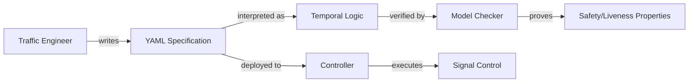
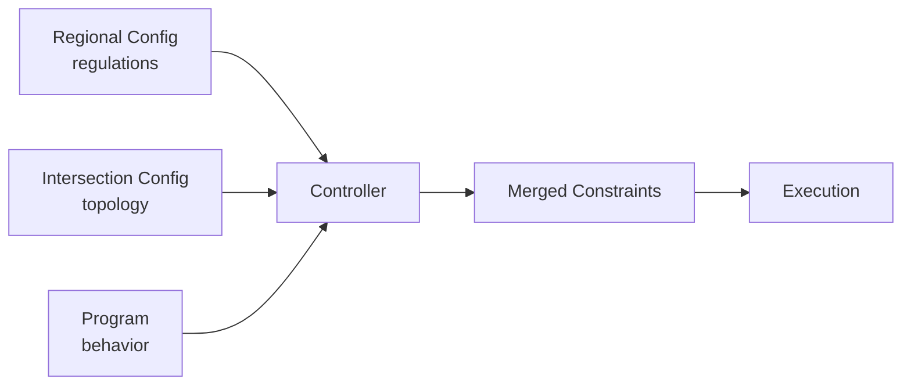

# Constraint-Based Traffic Light Programming

## Overview
This document describes a novel approach to traffic light control based on **constraint programming** rather than traditional phase-based programming. Instead of defining fixed phases and transitions, traffic engineers specify **what must not happen** (conflicts, safety rules) and **what should happen** (service requirements, priorities), allowing the controller to dynamically find optimal signal timing.

A group-based program is flexible type of control strategy based on defining contrainst and sensor input. The controller then determines
all state changes.

Constrains can be minimum and maximum times, groups that must or must not be green at the same time, etc.

If you define enough constrainst in can become a fixed-time program. Or if you define very few constrains it
can behave like a fully adaptive program. It's common to conceptually work with stages, although this is just one way to use the strategy.

## Prerequisites
Running a group-based  program depends on regional, controller and intersection [configurations](configurations.md), which are defined outside the
signal program.

Specifically, signal groups and the conflict matrix are defines in the intersection configurarion, not in the signal program.

Similary, regional settings like red-yellow time is defined in the regional/controller/intersection configuration, not in the signal program.

Controllers must use UTC [synchronized](synchronization.md) using NTP.

### Key Principles

1. **Declarative over Imperative**: Specify constraints and objectives, not explicit control sequences
2. **Group-Based Control**: Each signal group operates semi-independently within constraints
3. **Emergent Behavior**: Cycles and coordination patterns emerge from constraints rather than being explicitly programmed
4. **Distributed Optimization**: Intersections coordinate through minimal information sharing
5. **Predictable Safety**: Hard constraints ensure safety is never violated
6. **Flexible Optimization**: Controllers compete on algorithm quality while respecting constraints

## Philosophy

Traditional traffic light programming requires traffic engineers to:
- Define complete phase sequences
- Program exact timing for each phase
- Handle all possible traffic scenarios explicitly
- Update entire programs when requirements change

Constraint-based programming allows traffic engineers to:
- Start with basic safety rules (conflict matrix, intergreen times)
- Progressively add constraints to guide behavior
- Let the controller optimize within constraints
- Modify constraints incrementally without rewriting programs

### Separation of Concerns

```
Traffic Engineer defines:     WHAT (Constraints)
├─ Safety rules               → Conflicts, intergreen times
├─ Timing requirements        → Min/max green times
├─ Service requirements       → Fairness, responsiveness
└─ Optimization goals         → Minimize delays, stops

Controller implements:        HOW (Algorithm)
├─ Constraint satisfaction    → Ensures rules are met
├─ Optimization strategy      → Finds best solution
└─ Real-time adaptation       → Responds to demand
```

This separation enables:
- **Portability**: Same constraints run on different controllers
- **Innovation**: Manufacturers compete on optimization algorithms
- **Verification**: Can prove constraints are never violated
- **Maintainability**: Change constraints without understanding algorithms

## Temporal Logic Notation

Many constraints in this system involve properties that must hold over time. We use **temporal logic** to precisely specify these properties. Temporal logic extends regular logic with operators that reason about time and state changes.

### Logical Operators

First, the basic logical operators used throughout:

| Operator | Symbol | Meaning | Example |
|----------|--------|---------|---------|
| **Not** | ¬ | Negation/opposite | ¬(green) = "not green" |
| **And** | ∧ | Both conditions true | (sg1.green ∧ sg2.red) = "sg1 green AND sg2 red" |
| **Or** | ∨ | At least one condition true | (green ∨ yellow) = "green OR yellow" |
| **Implies** | → | If...then | (green → ¬red) = "if green then not red" |

### Temporal Operators

| Operator | Symbol | Meaning | Example |
|----------|--------|---------|---------|
| **Always** | □ | Property holds at all times | □ (safe) = "always safe" |
| **Eventually** | ◇ | Property holds at some future time | ◇ (green) = "eventually green" |
| **Next** | ○ | Property holds in the next state | ○ (red) = "next state is red" |
| **Until** | U | Property holds until another becomes true | (green U red) = "green until red" |

### Time-Bounded Operators (Metric Temporal Logic)

For real-time systems like traffic control, we use **Metric Temporal Logic (MTL)**, which extends basic temporal logic with explicit timing constraints. This allows us to express precise timing requirements:

| Operator | Meaning | Example |
|----------|---------|---------|
| ◇≤t | Eventually within t seconds | ◇≤30s (green) = "green within 30 seconds" |
| ◇[t1,t2] | Eventually between t1 and t2 seconds | ◇[28s,32s] (green) = "green between 28-32 seconds" |
| □≤t | Always for at least t seconds | □≤10s (green) = "stay green for at least 10 seconds" |

### Common Patterns in Traffic Control

**Safety (always avoid conflicts):**
```
□ (sg1.green → ¬sg2.green)
"Always: if signal group 1 is green, signal group 2 is not green"
```

**Liveness (eventually serve all groups):**
```
□◇ (sg1.green)
"Always eventually: signal group 1 becomes green"
(Infinitely often - true cycles)
```

**Timing bounds:**
```
□ (sg1.green → ◇≤60s ¬sg1.green)
"Always: if sg1 is green, it will not be green within 60 seconds"
(Enforces maximum green time)
```

**Service guarantee:**
```
□ (sg1.demand → ◇≤120s sg1.green)
"Always: if sg1 has demand, it goes green within 120 seconds"
(Prevents starvation)
```

**Intergreen timing:**
```
□ (sg1.green_end → (¬sg2.green U (time_elapsed ≥ 4s)))
"Always: after sg1 ends green, sg2 stays not-green until 4 seconds elapsed"
(Safety clearance)
```

**State transitions:**
```
□ (sg1.green → ○ (sg1.green ∨ sg1.yellow))
"Always: green is followed by green or yellow"
(Never skip yellow phase)
```

**Coordination:**
```
□ (a.sg1.green_start → ◇[28s,32s] b.sg1.green_start)
"Always: when intersection A's sg1 goes green, 
intersection B's sg1 goes green 28-32 seconds later"
(Green wave coordination)
```

### Quantifiers

For expressing properties over multiple signal groups:

| Operator | Symbol | Meaning | Example |
|----------|--------|---------|---------|
| **For all** | ∀ | Property holds for every element | ∀sg: □◇ (sg.green) = "every signal group eventually goes green" |
| **Exists** | ∃ | Property holds for at least one element | ∃sg: sg.green = "at least one signal group is green" |
| **If and only if** | ↔ | Equivalence/bidirectional | (sg1.green ↔ sg2.green) = "sg1 and sg2 always have same state" |

### Why Temporal Logic?

Temporal logic provides several advantages:

1. **Precision**: Unambiguous specification of time-dependent properties
2. **Verification**: Can be checked by model checking tools (SPIN, NuSMV, UPPAAL)
3. **Completeness**: Covers all possible execution paths, not just test cases
4. **Documentation**: Clear mathematical specification of requirements
5. **Tool Support**: Many verification tools understand temporal logic

### From Temporal Logic to Implementation

Traffic engineers don't need to write temporal logic directly. Instead:

```yaml
# Traffic engineer writes (YAML):
constraints:
  conflicts:
    - groups: [sg1, sg2]

# System interprets as temporal logic:
# □ (sg1.green → ¬sg2.green)

# Controller implements:
# Before allowing sg1 green, check sg2 is not green
```

The temporal logic formulas document **what the system must do**, while controllers implement **how to do it**.

### Natural Language Alternative

For readability, constraints can also be expressed in structured natural language:

```yaml
constraints:
  safety:
    - "always: sg1 green implies sg2 not green"
    - "always: after sg1 ends green, wait 4 seconds before sg2 can start green"
    
  liveness:
    - "always eventually: sg1 becomes green"
    - "always: if sg1 has demand, then within 120 seconds sg1 becomes green"
```

These natural language expressions are translated to temporal logic internally for verification.

### How Temporal Logic is Used

**Temporal logic serves three purposes in this system:**

1. **Formal Semantics** - Defines precisely what each YAML constraint means
2. **Documentation** - Provides unambiguous specification for discussion and reasoning
3. **Verification** - Enables model checkers to prove properties hold

**The practical workflow:**



**Key point:** Traffic engineers write YAML, not temporal logic. The temporal logic formulas document what the YAML means and enable formal verification.

**Throughout this document:** Each constraint type will show its YAML specification alongside its temporal logic semantics. This provides both the practical format (YAML) and the formal meaning (temporal logic).

## Constraint Types

Constraints are categorized by how strictly they must be satisfied:

### Hard Constraints (Must Never Violate)

Hard constraints define safety-critical rules that must always be satisfied. Violation of a hard constraint indicates a system failure.

```yaml
priority: critical
violation: system_error
```

### Soft Constraints (Optimization Objectives)

Soft constraints define preferences and objectives that the controller should try to satisfy but may be relaxed if necessary.

```yaml
priority: variable
violation: suboptimal_performance
```

## Constraint Specification Format

Constraints are organized into separate configuration files that are merged when deployed to a controller:



### Configuration Layers

**1. Regional Configuration** (applies to all intersections in a region)
```yaml
# regional_config.yaml - mandated by regulation
region: "sweden_stockholm"
version: "2024.1"

regulations:
  yellow_times:
    default: 3      # seconds
    speed_50: 3
    speed_70: 4
    
  all_red_times:
    default: 2      # seconds
    
  minimum_green_times:
    vehicle: 5      # seconds
    pedestrian: 6
    bicycle: 8
    
  maximum_green_times:
    default: 120    # seconds, regulatory maximum
```

**2. Intersection Configuration** (physical topology)
```yaml
# intersection_config.yaml - site-specific physical layout
intersection:
  id: "main_street_oak_ave"
  location: { lat: 59.334, lon: 18.063 }
  
  signal_groups:
    sg1:
      description: "North-South through traffic"
      type: "vehicle"
      approach_speed: 50  # km/h
      
    sg2:
      description: "East-West through traffic"
      type: "vehicle"
      approach_speed: 50
      
    sg_ped:
      description: "Pedestrian North-South"
      type: "pedestrian"
      crossing_distance: 12  # meters
  
  # Derived from physical layout - cannot change
  conflicts:
    - groups: [sg1, sg2]
      reason: "Perpendicular traffic flows"
    - groups: [sg1, sg_ped]
      reason: "Pedestrian crossing"
  
  # Calculated from layout and regulation
  intergreens:
    - from: sg1
      to: sg2
      min_time: 4    # calculated from intersection size + speed
      calculation: "clearing_time + perception_reaction"
      
  detectors:
    d1: { type: "loop", location: "NS approach 50m" }
    d2: { type: "button", location: "Ped crossing north" }
```

**3. Program** (operational behavior)
```yaml
# program.yaml - traffic engineer defines behavior
program:
  id: "main_intersection_actuated_v1"
  version: "1.0"
  description: "Vehicle-actuated control with pedestrian priority"
  
  # Program-specific timing (within regulatory limits)
  timing:
    sg1:
      min_green: 10      # above regulatory minimum of 5s
      max_green: 60      # below regulatory maximum of 120s
      
    sg2:
      min_green: 8
      max_green: 45
      
    sg_ped:
      min_green: 15      # above regulatory minimum of 6s
      max_green: 20
  
  # Detector logics - how detectors create demand
  detector_logics:
    - detectors: [d1]
      creates_demand_for: sg1
      priority: 5
      
    - detectors: [d2]
      creates_demand_for: sg_ped
      priority: 8       # pedestrians get higher priority
      
  # Extension logic
  extension_rules:
    - signal_group: sg1
      detector: d1
      type: "gap_out"
      gap_time: 3
      max_extension: 20
  
  # Optimization objectives
  objectives:
    - type: "minimize_delay"
      weight: 1.0
    - type: "minimize_stops"
      weight: 0.8
```

### Merging Process

When deployed to the controller, configurations are merged:

```yaml
# Merged effective constraints
merged_constraints:
  signal_groups:
    sg1:
      type: "vehicle"                    # from intersection config
      yellow_time: 3                     # from regional config (speed_50)
      all_red_time: 2                    # from regional config
      min_green: 10                      # from program (≥ regional min of 5)
      max_green: 60                      # from program (≤ regional max of 120)
      
  conflicts:
    - groups: [sg1, sg2]                 # from intersection config
    
  intergreens:
    - from: sg1, to: sg2, min_time: 4    # from intersection config
    
  demand_rules:
    - detectors: [d1]                    # from program
      creates_demand_for: sg1
      priority: 5
```

### Validation Rules

When merging, the controller validates:

```yaml
validation:
  - check: "program.sg1.min_green ≥ regional.minimum_green_times.vehicle"
    error: "Program violates regulatory minimum green time"
    
  - check: "program.sg1.max_green ≤ regional.maximum_green_times.default"
    error: "Program exceeds regulatory maximum green time"
    
  - check: "all signal_groups in program exist in intersection_config"
    error: "Program references undefined signal group"
    
  - check: "all detectors in program exist in intersection_config"
    error: "Program references undefined detector"
```

### Benefits of Separation

**Regional Configuration:**
- Maintained by regulatory authority
- Ensures legal compliance
- Updates apply to all intersections automatically
- Cannot be overridden by programs

**Intersection Configuration:**
- Maintained by site engineer
- Reflects physical reality
- Changes only when infrastructure changes
- Verified against survey data

**Program:**
- Maintained by traffic engineer
- Defines operational behavior
- Can be updated frequently
- Multiple programs per intersection (morning, evening, weekend)

This separation ensures:
- **Compliance**: Regulations always enforced
- **Safety**: Physical conflicts always respected
- **Flexibility**: Programs can be updated independently
- **Reusability**: Same program can be adapted to similar intersections

## Available Constraints

### 1. Conflict Constraints (Hard)

Defines which signal groups cannot be green simultaneously due to conflicting traffic movements.

**YAML Specification:**
```yaml
constraints:
  conflicts:
    - groups: [sg1, sg2]
      reason: "Perpendicular traffic flows"
      
    - groups: [sg1, sg3]
      reason: "Pedestrians crossing sg1 path"
      
    - groups: [sg2, sg4]
      reason: "Left turn conflicts with through traffic"
```

**Temporal Logic Semantics:**
```
□ ¬(sg1.green ∧ sg2.green)
□ ¬(sg1.green ∧ sg3.green)
□ ¬(sg2.green ∧ sg4.green)
```

**Meaning:** At all times, conflicting signal groups cannot both be green simultaneously.

**Properties:**
- **Type**: Hard constraint
- **Always active**: Cannot be overridden
- **Symmetric**: If sg1 conflicts with sg2, then sg2 conflicts with sg1
- **Transitivity**: Not transitive (sg1↔sg2 and sg2↔sg3 doesn't imply sg1↔sg3)

**Derived Properties:**
- Compatible groups can be green simultaneously
- Creates constraint graph for solver

### 2. Intergreen Time Constraints (Hard)

Defines minimum clearance time between one signal group ending and a conflicting group starting.

**YAML Specification:**
```yaml
constraints:
  intergreens:
    - from: sg1
      to: sg2
      min_time: 4
      reason: "Vehicle clearance time"
      
    - from: sg1
      to: sg3
      min_time: 3
      reason: "Pedestrian clearance"
      
    - from: sg2
      to: sg1
      min_time: 4
```

**Temporal Logic Semantics:**
```
□ ((sg1.green_end ∧ ◇sg2.green_start) → 
   (¬sg2.green U (time_since(sg1.green_end) ≥ 4s)))
```

**Simplified:**
```
□ (sg1.green_end → ◇≥4s sg2.green_start)
```

**Meaning:** Always, when sg1 ends green, if sg2 will start green, at least 4 seconds must elapse first.

**Properties:**
- **Type**: Hard constraint
- **Units**: Seconds
- **Not symmetric**: sg1→sg2 may differ from sg2→sg1
- **Safety critical**: Prevents collisions during transitions

**Implementation:**
```
When sg1 goes red at time T:
  sg2.earliest_green_time = T + 4 seconds
```

### 3. Timing Constraints (Hard)

Defines minimum and maximum duration bounds for signal groups.

```yaml
# In program specification:
program:
  timing:
    sg1:
      min_green: 10        # program-defined (≥ regulatory minimum)
      max_green: 60        # program-defined (≤ regulatory maximum)
      # yellow_time comes from regional config
      # all_red_time comes from regional config
      
    sg2:
      min_green: 8
      max_green: 45

# Yellow and all-red times come from regional configuration:
# regional_config.yaml:
#   yellow_times:
#     speed_50: 3
#   all_red_times:
#     default: 2
```

**Temporal Logic Semantics:**

**Minimum Green Time:**
```
□ (sg.green_start → □≥min_green sg.green)
```
Meaning: If a signal group goes green, it stays green for at least min_green seconds.

**Maximum Green Time:**
```
□ (sg.green_start → ◇≤max_green ¬sg.green)
```
Meaning: If a signal group goes green, within max_green seconds it must not be green anymore.

**Yellow Time:**
```
□ (sg.yellow_start → (□<yellow_time sg.yellow ∧ ◇=yellow_time sg.red))
```
Meaning: When yellow starts, it lasts exactly yellow_time seconds, then transitions to red.

**State Transitions:**
```
□ (sg.green → ○(sg.green ∨ sg.yellow))
"Green is followed by green or yellow (never directly to red)"

□ (sg.yellow → ○sg.red)
"Yellow is always followed by red"

□ ¬(sg.yellow → ○sg.green)
"Yellow cannot transition back to green"

□ ¬(sg.green → ○sg.red)
"Green cannot transition directly to red"
```

**Properties:**

**Minimum Green Time:**
- **Type**: Hard constraint
- **Purpose**: Ensure drivers can respond to green signal
- **Regulation**: Often legally mandated
- **Source**: Can be set in program (≥ regulatory minimum)

**Maximum Green Time:**
- **Type**: Hard constraint  
- **Purpose**: Prevent monopolization, ensure fairness
- **Creates cycles**: Forces transitions even with continuous demand
- **Source**: Can be set in program (≤ regulatory maximum)

**Yellow Time:**
- **Type**: Hard constraint
- **Purpose**: Allow vehicles to clear intersection safely
- **Source**: Regional configuration (mandated by regulation)
- **Calculation**: Based on approach speed and stopping distance

**All-Red Time:**
- **Type**: Hard constraint
- **Purpose**: Additional safety clearance
- **Source**: Regional configuration (mandated by regulation)
- **Applied**: After yellow, before conflicting green

### 4. Coordination Constraints (Soft)

Defines relationships between signal groups, either at the same intersection or across intersections.

#### Local Coordination (Same Intersection)

```yaml
constraints:
  coordination:
    - type: "prefer_together"
      groups: [sg1, sg2]
      reason: "Coordinate parallel movements"
      strength: 0.8
      
    - type: "prefer_sequential"
      groups: [sg1, sg3]
      order: [sg1, sg3]
      reason: "Protected left turn after through movement"
      strength: 0.6
```

#### Network Coordination (Multiple Intersections)

Coordination constraints are specified from the perspective of the current intersection. You define how this intersection should coordinate with other intersections.

**YAML Specification:**

```yaml
# In intersection B's configuration
network_constraints:
  - type: "offset_relationship"
    other_intersection: "intersection_a"
    my_signal_group: sg1
    my_event: green_start
    their_signal_group: sg1
    their_event: green_start
    offset_range: [28, 32]  # seconds (my_event after their_event)
    priority: medium
    reason: "Arterial progression northbound - vehicles take ~30s to travel from A to B"
```

```yaml
# Bidirectional coordination example:
# In intersection B's configuration for both directions
network_constraints:
  # Northbound progression (from A to B)
  - type: "offset_relationship"
    other_intersection: "intersection_a"
    my_signal_group: sg1  # northbound at B
    my_event: green_start
    their_signal_group: sg1  # northbound at A
    their_event: green_start
    offset_range: [28, 32]  # B goes green 28-32s after A
    priority: high
    reason: "Northbound progression A→B"
    
  # Southbound progression (from B to C, or B leading A)
  - type: "offset_relationship"
    other_intersection: "intersection_c"
    my_signal_group: sg2  # southbound at B
    my_event: green_start
    their_signal_group: sg2  # southbound at C
    their_event: green_start
    offset_range: [25, 30]  # C goes green 25-30s after B
    priority: high
    reason: "Southbound progression B→C"
```

**Temporal Logic Semantics:**

```
□ (intersection_a.sg1.green_start → ◇[28s,32s] this.sg1.green_start)
```

**Meaning:** This intersection tries to start its sg1 green 28-32 seconds after intersection A's sg1 goes green, creating a green wave for vehicles traveling from A to here.

**Properties:**
- **Type**: Soft constraint
- **Can be violated**: If necessary to satisfy hard constraints
- **Priority levels**: high, medium, low
- **Tolerance**: Specified as range, not exact value
- **Unidirectional**: Each intersection specifies its own coordination relationships

**Benefits:**
- Green wave along arterial roads
- Reduced stops and delays
- Improved traffic flow
- Lower fuel consumption

**Information Sharing:**
Intersections broadcast their own events, receive events from others:
```yaml
# What this intersection broadcasts:
outbound_event:
  signal_group: sg1
  event: green_start
  timestamp: 14:23:45.123
  estimated_duration: 45

# What this intersection receives from intersection_a:
inbound_event:
  from: intersection_a
  signal_group: sg1
  event: green_start
  timestamp: 14:23:15.123
```

Each intersection only knows about intersections it explicitly coordinates with. No global knowledge required.

### 5. Service Constraints (Hard/Soft)

Defines requirements for serving signal groups with demand.

**YAML Specification:**
```yaml
constraints:
  service:
    # Liveness - all groups must eventually be served
    - type: "liveness"
      description: "Every signal group eventually goes green"
      constraint_type: hard
      
    # Maximum wait time (anti-starvation)
    - type: "max_wait"
      signal_group: sg1
      max_wait: 120  # seconds
      condition: "has_demand"
      description: "When sg1 has demand, serve within 120s"
      constraint_type: hard
      
    # Minimum service frequency
    - type: "min_frequency"
      signal_group: sg_ped
      max_cycle_time: 180  # seconds
      condition: "has_demand"
      description: "Pedestrians served at least every 3 minutes"
      constraint_type: soft
      priority: medium
```

**Temporal Logic Semantics:**

**Liveness:**
```
∀sg: □◇ sg.green
```
Meaning: For all signal groups, always eventually the signal goes green (infinitely often).

**Maximum Wait:**
```
□ (sg1.demand → ◇≤120s sg1.green)
```
Meaning: Always, if sg1 has demand, within 120 seconds it must go green.

**Minimum Frequency:**
```
□ (sg_ped.demand → □◇≤180s sg_ped.green)
```
Meaning: Always, if pedestrian group has demand, it goes green at least every 180 seconds.

**Properties:**

**Liveness (Hard):**
- Prevents deadlock
- Ensures all groups eventually served
- Critical for system correctness

**Maximum Wait (Hard):**
- Prevents starvation
- Triggered when demand present
- May force service even if suboptimal

**Minimum Frequency (Soft):**
- Ensures regular service
- Can be relaxed under heavy conflicting demand

### 6. Priority Constraints (Soft)

Defines relative importance of different signal groups or requests.

```yaml
constraints:
  priorities:
    # Base priorities
    sg1: 10  # main arterial
    sg2: 5   # side street
    sg3: 3   # pedestrian
    
    # Priority modifiers
    priority_rules:
      - condition: "bus_detected"
        signal_group: sg1
        boost: +10
        duration: 60  # seconds
        reason: "Transit priority"
        
      - condition: "emergency_vehicle"
        signal_group: "*"  # any group on route
        boost: +100
        reason: "Emergency route"
        
      - condition: "wait_time > 90s"
        boost: +5
        reason: "Fairness - waited too long"
```

**Priority Resolution:**
```
When multiple groups request green:
1. Filter by hard constraints (conflicts, intergreen)
2. Sort by effective priority:
   effective_priority = base_priority + modifiers + wait_time_bonus
3. Select highest priority candidate
4. Apply tie-breaking (by group ID)
```

### 7. Cycle Constraints (Soft)

Defines preferred cycle characteristics. Note: Cycles are not explicitly programmed but emerge from constraints.

```yaml
constraints:
  cycle:
    # Emergent cycle time bounds
    min_cycle_time: 60   # Don't cycle too fast
    max_cycle_time: 120  # Don't cycle too slow
    target_cycle_time: 90  # Preferred cycle length
    
    # Minimum service per cycle
    min_green_ratio:
      sg1: 0.3  # At least 30% of cycle time
      sg2: 0.2  # At least 20% of cycle time
```

**Properties:**
- Cycles emerge naturally from max_green constraints + fairness
- Cycle time constraints are additional bounds
- Useful for coordination and predictability

**Emergence:**
```
Without explicit cycle time:
- Each group limited by max_green
- All groups must be served (fairness)
- Conflicts limit concurrency
→ Controller cycles through groups
→ Cycle time = Σ(green_times + transitions)
→ Bounded by Σ(max_green + yellow + intergreen)
```

## Sensor-Based Constraints

Sensors don't directly control signals; they generate **requests** that feed into the constraint solver.

### Detector Configuration

```yaml
detectors:
  d1:
    type: "loop"
    location: "northbound_approach_50m"
    description: "Vehicle detection"
    
  d2:
    type: "loop"
    location: "northbound_stop_line"
    description: "Stop line detection for gap-out"
    
  d3:
    type: "button"
    location: "pedestrian_crossing_north"
    description: "Pedestrian button"
    
  d4:
    type: "transponder"
    location: "northbound_200m"
    description: "Bus priority detection"
```

### Detector Logics

Detector logics define how sensors trigger **demand** for signal groups:

```yaml
detector_logics:
  # Basic vehicle demand
  - name: "vehicle_demand_northbound"
    detectors: [d1, d2]  # OR logic
    creates_demand_for: sg1
    priority: 5
    
  # Pedestrian demand with service requirements
  - name: "pedestrian_crossing"
    detectors: [d3]
    creates_demand_for: sg_ped
    priority: 3
    constraints:
      - type: "min_green_when_served"
        value: 15  # seconds
        reason: "Pedestrians need time to cross"
      - type: "max_wait"
        value: 60  # seconds
        reason: "Safety - pedestrians should not wait too long"
    
  # Bus priority
  - name: "bus_priority"
    detectors: [d4]
    creates_demand_for: sg1
    priority: 15  # higher than normal vehicles
    advance_notice: 20  # seconds
    constraints:
      - type: "max_wait"
        value: 30  # seconds
        reason: "Bus schedule adherence"
```

### Extension Logic (Vehicle-Actuated Control)

Detectors can modify green duration dynamically:

```yaml
extension_rules:
  - name: "gap_out_northbound"
    signal_group: sg1
    detector: d2  # stop line detector
    logic: "gap_out"
    gap_time: 3   # seconds
    max_extension: 20  # seconds
    
    behavior:
      - "While sg1 is green"
      - "If detector sees vehicle, extend green"
      - "If no vehicle for 3 seconds, allow yellow"
      - "Never extend beyond min_green + max_extension"
```

**Gap-Out Logic:**
```
sg1 goes green at T=0:
  T=0-10s:  min_green period, must stay green
  T=10s:    min_green satisfied, can now gap out
  T=12s:    vehicle detected on d2, continue green
  T=15s:    vehicle detected on d2, continue green
  T=18s:    no vehicle for 3s → gap out → yellow
  
Alternative scenario:
  T=10-30s: continuous vehicles, extend green
  T=30s:    max_extension reached → force yellow
```

### Recall Modes

Some signal groups have continuous or periodic demand:

```yaml
recall_rules:
  - signal_group: sg1
    mode: "minimum"
    reason: "Main arterial should always get minimum service"
    behavior: "Always request at least min_green, even without detector"
    
  - signal_group: sg2
    mode: "none"
    reason: "Side street - actuated only"
    behavior: "Only request when detector active"
    
  - signal_group: sg_ped
    mode: "none"
    reason: "Pedestrian actuated"
    behavior: "Only request when button pressed"
```

**Recall Types:**
- **None**: Only serve when detector active
- **Minimum**: Always serve with min_green (even without detector)
- **Maximum**: Always serve with max_green (like fixed-time)
- **Pedestrian**: Periodic service for pedestrian phases

### Priority Detection

Special vehicles modify priorities:

```yaml
priority_detection:
  - name: "bus_priority"
    detector: d4
    vehicle_type: "bus"
    signal_group: sg1
    
    priority_boost: +10
    advance_notice: 20  # seconds
    
    actions:
      - "Create high-priority request for sg1"
      - "If sg1 is green, extend by up to 10 seconds"
      - "If sg1 is red, try to go green within 25 seconds"
    
    constraints:
      - "Still respect safety constraints (conflicts, intergreens)"
      - "Still respect minimum service for other groups"
      - "May delay lower-priority groups"
```

### Sensor State Flow

```
Physical Sensors
      ↓
Detector State (true/false)
      ↓
Demand Rules (evaluate conditions)
      ↓
Signal Group Requests (with priorities)
      ↓
Constraint Solver (optimization)
      ↓
Signal States (red/yellow/green)
```

**Key Insight:** Sensors don't directly control signals. They create **inputs** to the optimization problem.

### Testing with Forced Inputs

The RSMP `force_input` command simulates detector activation:

```ruby
force_input(input: 1, status: 'True')
# Equivalent to detector d1 being active
# Triggers same demand rules
# Produces deterministic output
```

This enables:
- Reproducible testing
- Scenario simulation
- Verification without physical traffic

## Optimization Objectives

While hard constraints define what's safe, soft constraints and objectives define what's optimal.

```yaml
objectives:
  # Minimize total delay
  - type: "minimize_delay"
    weight: 1.0
    description: "Sum of vehicle wait times"
    
  # Minimize number of stops
  - type: "minimize_stops"
    weight: 0.8
    description: "Vehicles that stop vs. cruise through"
    
  # Maximize throughput
  - type: "maximize_throughput"
    weight: 0.6
    description: "Vehicles processed per hour"
    
  # Fairness
  - type: "fairness"
    weight: 0.5
    description: "Balance service between groups"
    params:
      max_wait_time: 120
      min_service_ratio: 0.1
```

**Multi-Objective Optimization:**
```
Controller computes:
  score = Σ(weight[i] × objective[i])
  
Selects action that maximizes score while respecting all hard constraints.
```

## Verification

Constraint specifications can be formally verified:

### Static Verification (Fast)

Check structural consistency:

```yaml
checks:
  - "No group conflicts with itself"
  - "Conflicts are symmetric"
  - "min_green ≤ max_green for all groups"
  - "Intergreen times are non-negative"
  - "All referenced detectors exist"
  - "Conflict graph allows at least one group green"
```

### Model Checking (Exhaustive)

Prove temporal properties:

```yaml
properties:
  - id: "no_conflicting_greens"
    formula: "□ (sg1.green → ¬sg2.green)"
    status: proven
    
  - id: "all_groups_eventually_served"
    formula: "∀sg: □◇ sg.green"
    status: proven
    
  - id: "max_wait_respected"
    formula: "□ (sg.demand → ◇≤120s sg.green)"
    status: proven
```

### Simulation (Empirical)

Test with realistic scenarios:

```yaml
test_scenarios:
  - name: "morning_rush_hour"
    duration: 3600  # seconds
    traffic_pattern: "heavy_nb_sb"
    verify:
      - "No constraint violations"
      - "All groups served"
      - "Average wait < 45s"
      
  - name: "bus_priority_with_cross_traffic"
    sequence:
      - t=0: set d6 active  # cross traffic
      - t=5: set d4 active  # bus detected
    verify:
      - "Bus served within 30s"
      - "Cross traffic gets min_green"
```

## Implementation Notes

### Controller Requirements

Any controller implementing this specification must:

1. **Validate constraints** before deployment
2. **Check constraints** before every state change
3. **Reject transitions** that would violate hard constraints
4. **Log violations** if they occur (system error)
5. **Provide observability** (current state, pending requests, decisions)

### Reference Implementation

A reference implementation should provide:

- **Deterministic algorithm** (same inputs → same outputs)
- **Simple greedy strategy** (priority-based selection)
- **Constraint validator** (verifies any controller's behavior)
- **Test harness** (replay scenarios, compare results)

Used for:
- Certifying controllers
- Debugging issues
- Validating specifications
- Comparing performance

### Manufacturer Innovation

Manufacturers can compete on:

- **Optimization algorithms** (better throughput, lower delays)
- **Prediction** (use historical data, machine learning)
- **Adaptiveness** (respond to changing patterns)
- **Efficiency** (faster computation)

As long as they:
- Never violate hard constraints
- Respond correctly to RSMP commands
- Provide required observability

## Benefits

### For Traffic Engineers

- **Intuitive**: Specify rules, not algorithms
- **Incremental**: Start simple, add constraints progressively
- **Maintainable**: Change constraints without rewriting programs
- **Verifiable**: Prove safety properties
- **Portable**: Same constraints work on different controllers

### For Manufacturers

- **Innovation**: Compete on optimization quality
- **Flexibility**: Use any algorithm (greedy, MPC, RL, etc.)
- **Differentiation**: Provide value through better performance
- **Compatibility**: Standard constraint format

### For System Operators

- **Safety**: Constraints ensure safety never violated
- **Predictability**: Known bounds on behavior
- **Flexibility**: Can swap controllers without reprogramming
- **Observability**: Clear understanding of why decisions made

### For the Network

- **Scalability**: Distributed optimization, no central bottleneck
- **Resilience**: Graceful degradation on failures
- **Coordination**: Emergent network behavior from local rules
- **Adaptability**: Easy to add/modify intersections

## Future Directions

### Predictive Control

With vehicle-to-infrastructure (V2I) communication:

```yaml
planning_horizon: 60  # seconds

# Optimize over time window, not just current instant
# Consider known vehicle arrivals
# Broadcast planned signal changes to vehicles
# Enable vehicles to adjust speed (avoid stops)
```

### Learning and Adaptation

```yaml
# Controllers could learn from experience:
- Historical demand patterns
- Effective coordination strategies  
- Optimal objective weights
- Anomaly detection

# While always respecting hard constraints
```

### Multi-Modal Optimization

```yaml
objectives:
  - minimize_vehicle_delay: 0.6
  - minimize_pedestrian_wait: 0.3
  - minimize_bicycle_stops: 0.2
  - minimize_emissions: 0.4
  - minimize_noise: 0.1
```

## Conclusion

Constraint-based programming represents a paradigm shift from imperative to declarative traffic control. By specifying **what** rather than **how**, we enable:

- Safer systems (constraints provably never violated)
- More flexible control (controllers optimize within bounds)
- Easier maintenance (modify constraints, not algorithms)
- Better coordination (emergent network behavior)
- Continuous improvement (algorithms advance independently)

The constraint specification becomes the **contract** between traffic engineers, controller manufacturers, and safety requirements—a clear, verifiable foundation for modern traffic control systems.

---

## Appendix: Example Complete Specification

This example shows how the three configuration layers work together.

### Regional Configuration (Sweden)

```yaml
# regional_config_sweden.yaml
# Maintained by: Swedish Transport Administration
# Applies to: All intersections in Sweden

region: "sweden"
version: "2024.1"

regulations:
  yellow_times:
    speed_30: 3
    speed_50: 3
    speed_70: 4
    
  all_red_times:
    default: 2
    
  minimum_green_times:
    vehicle: 5
    pedestrian: 6
    bicycle: 8
    
  maximum_green_times:
    default: 120
```

**Temporal Logic Interpretation:**

These regulations translate to temporal logic requirements that apply to all intersections:

```
Yellow Time (mandatory duration):
  ∀sg: (sg.type = vehicle ∧ sg.approach_speed = 50) → 
    □ (sg.yellow_start → (□<3s sg.yellow ∧ ◇=3s sg.red))
  "All vehicle signals with 50 km/h approach must stay yellow exactly 3 seconds"

All-Red Time (safety clearance):
  ∀sg: □ (sg.yellow_end → □≥2s (∀conflicting: ¬conflicting.green))
  "After any signal's yellow ends, all conflicting signals stay red for at least 2 seconds"

Minimum Green Time (cannot violate):
  ∀sg: sg.type = vehicle → 
    □ (sg.green_start → □≥5s sg.green)
  "All vehicle signals must stay green for at least 5 seconds once started"
  
  ∀sg: sg.type = pedestrian → 
    □ (sg.green_start → □≥6s sg.green)
  "All pedestrian signals must stay green for at least 6 seconds once started"

Maximum Green Time (cannot exceed):
  ∀sg: □ (sg.green_start → ◇≤120s ¬sg.green)
  "All signals must end green within 120 seconds"
```

**Key Properties:**

- **Legally mandated**: These constraints cannot be overridden by any program
- **Safety critical**: Violating these is illegal and unsafe
- **Universal quantification**: Apply to ALL signal groups of matching type
- **Hard constraints**: Must always be satisfied, never relaxed

### Intersection Configuration

```yaml
# intersection_main_oak.yaml
# Maintained by: Site engineer
# Describes: Physical intersection at Main St & Oak Ave

intersection:
  id: "main_oak_001"
  location: { lat: 59.334, lon: 18.063 }
  description: "4-way intersection with pedestrian crossings"
  
signal_groups:
  sg1:
    description: "North-South through traffic"
    type: "vehicle"
    approach_speed: 50  # km/h
    
  sg2:
    description: "East-West through traffic"
    type: "vehicle"
    approach_speed: 50
    
  sg3:
    description: "Pedestrian North-South crossing"
    type: "pedestrian"
    crossing_distance: 10  # meters
    crossing_time: 15      # calculated

detectors:
  d1: { type: "loop", location: "NS approach 50m" }
  d2: { type: "loop", location: "EW approach 50m" }
  d3: { type: "button", location: "Ped NS crossing" }

# Physical conflicts (derived from layout)
conflicts:
  - groups: [sg1, sg2]
    reason: "Perpendicular flows"
  - groups: [sg1, sg3]
    reason: "Pedestrian crossing"
    
# Safety clearance times (calculated from layout)
intergreens:
  - { from: sg1, to: sg2, min_time: 4 }
  - { from: sg2, to: sg1, min_time: 4 }
  - { from: sg1, to: sg3, min_time: 3 }
  - { from: sg3, to: sg1, min_time: 2 }
```

**Temporal Logic Interpretation:**

The physical topology defines immutable safety constraints:

```
Signal Group Existence:
  signal_groups = {sg1, sg2, sg3}
  "These are the only controllable signal groups at this intersection"

Conflict Constraints (Hard):
  □ ¬(sg1.green ∧ sg2.green)
  "sg1 and sg2 can never be green simultaneously (perpendicular flows)"
  
  □ ¬(sg1.green ∧ sg3.green)
  "sg1 and sg3 can never be green simultaneously (pedestrian crossing)"
  
  Note: sg2 and sg3 are NOT in conflict (can be green together)

Intergreen Constraints (Hard):
  □ (sg1.green_end ∧ ◇sg2.green_start → ◇≥4s sg2.green_start)
  "After sg1 ends green, sg2 cannot start green for at least 4 seconds"
  
  □ (sg2.green_end ∧ ◇sg1.green_start → ◇≥4s sg1.green_start)
  "After sg2 ends green, sg1 cannot start green for at least 4 seconds"
  
  □ (sg1.green_end ∧ ◇sg3.green_start → ◇≥3s sg3.green_start)
  "After sg1 ends green, sg3 cannot start green for at least 3 seconds"
  
  □ (sg3.green_end ∧ ◇sg1.green_start → ◇≥2s sg1.green_start)
  "After sg3 ends green, sg1 cannot start green for at least 2 seconds"
```

**Key Properties:**

- **Immutable**: Cannot be changed without physical reconstruction
- **Derived from geometry**: Conflict and clearance times calculated from measurements
- **Site-specific**: Unique to this intersection's layout
- **Safety-critical**: Violations would cause crashes

### Program Specification

```yaml
# program_actuated_balanced.yaml
# Maintained by: Traffic engineer
# Purpose: Vehicle-actuated control with balanced priorities

program:
  id: "main_oak_actuated_v1"
  version: "1.0"
  description: "Actuated control with gap-out logic"
  
# Operational timing (within regulatory bounds)
timing:
  sg1: 
    min_green: 10   # ≥ regional minimum of 5s
    max_green: 60   # ≤ regional maximum of 120s
    
  sg2: 
    min_green: 8
    max_green: 45
    
  sg3: 
    min_green: 15   # ≥ regional minimum of 6s
    max_green: 20

# Service requirements
service:
  - { type: "max_wait", signal_group: sg1, max_wait: 120 }
  - { type: "max_wait", signal_group: sg2, max_wait: 120 }
  - { type: "max_wait", signal_group: sg3, max_wait: 60 }

# Detector behavior
demand_rules:
  - detectors: [d1]
    creates_demand_for: sg1
    priority: 5
    
  - detectors: [d2]
    creates_demand_for: sg2
    priority: 5
    
  - detectors: [d3]
    creates_demand_for: sg3
    priority: 3
    constraints:
      - type: "min_green_when_served"
        value: 15

extension_rules:
  - signal_group: sg1
    detector: d1
    type: "gap_out"
    gap_time: 3
    max_extension: 20
    
  - signal_group: sg2
    detector: d2
    type: "gap_out"
    gap_time: 3
    max_extension: 15

recall_rules:
  - { signal_group: sg1, mode: "minimum" }
  - { signal_group: sg2, mode: "none" }
  - { signal_group: sg3, mode: "none" }

objectives:
  - { type: "minimize_delay", weight: 1.0 }
  - { type: "fairness", weight: 0.5 }
```

**Temporal Logic Interpretation:**

The program defines operational behavior within regulatory and physical constraints:

```
Program-Specific Timing Constraints (Hard):
  □ (sg1.green_start → □≥10s sg1.green)
  "sg1 must stay green at least 10 seconds (more restrictive than regulatory 5s)"
  
  □ (sg1.green_start → ◇≤60s ¬sg1.green)
  "sg1 must end green within 60 seconds (more restrictive than regulatory 120s)"
  
  □ (sg2.green_start → □≥8s sg2.green)
  "sg2 must stay green at least 8 seconds"
  
  □ (sg2.green_start → ◇≤45s ¬sg2.green)
  "sg2 must end green within 45 seconds"
  
  □ (sg3.green_start → □≥15s sg3.green)
  "sg3 must stay green at least 15 seconds (more restrictive than regulatory 6s)"
  
  □ (sg3.green_start → ◇≤20s ¬sg3.green)
  "sg3 must end green within 20 seconds"

Service Constraints (Hard):
  □ (sg1.demand → ◇≤120s sg1.green)
  "When sg1 has demand, it must go green within 120 seconds"
  
  □ (sg2.demand → ◇≤120s sg2.green)
  "When sg2 has demand, it must go green within 120 seconds"
  
  □ (sg3.demand → ◇≤60s sg3.green)
  "When sg3 has demand, it must go green within 60 seconds (pedestrian priority)"

Demand Generation (Controller Input):
  d1.active → sg1.demand (priority=5)
  "Detector d1 creates demand for sg1 with priority 5"
  
  d2.active → sg2.demand (priority=5)
  "Detector d2 creates demand for sg2 with priority 5"
  
  d3.active → sg3.demand (priority=3)
  "Detector d3 creates demand for sg3 with priority 3"

Gap-Out Extension (Dynamic Green Time):
  sg1.green ∧ (time_since(sg1.green_start) ≥ 10s) ∧ ¬d1.active_for_3s → 
    ○sg1.yellow
  "sg1 can gap out after minimum green if no vehicle detected for 3 seconds"
  
  sg1.green ∧ (time_since(sg1.green_start) ≥ 30s) → ○sg1.yellow
  "sg1 must gap out after maximum extension (min_green + max_extension = 10+20)"

Recall Mode (Continuous Demand):
  □ sg1.demand
  "sg1 always has demand (minimum recall mode)"
  
  ¬d2.active → ¬sg2.demand
  "sg2 only has demand when detector active (no recall)"
  
  ¬d3.active → ¬sg3.demand
  "sg3 only has demand when button pressed (no recall)"

Optimization Objectives (Soft):
  Minimize: Σ(vehicle_wait_time) × 1.0
  "Primary objective: minimize total vehicle delay"
  
  Maximize: fairness_metric × 0.5
  "Secondary objective: balance service between groups"
```

**Key Properties:**

- **Configurable**: Can be changed without physical work
- **Constrained**: Must satisfy regulatory and physical constraints
- **Operational**: Defines day-to-day behavior
- **Multiple programs**: Same intersection can have different programs for different times/conditions

### Merged Result (at Controller)

When deployed, the controller merges all three layers:

```yaml
# Effective constraints at runtime
merged:
  signal_groups:
    sg1:
      type: "vehicle"           # from intersection
      approach_speed: 50        # from intersection
      yellow_time: 3            # from regional (speed_50)
      all_red_time: 2           # from regional
      min_green: 10             # from program (validated ≥ 5)
      max_green: 60             # from program (validated ≤ 120)
      
  conflicts:
    - [sg1, sg2]                # from intersection (immutable)
    - [sg1, sg3]
    
  intergreens:                  # from intersection (immutable)
    - { from: sg1, to: sg2, min_time: 4 }
    - { from: sg2, to: sg1, min_time: 4 }
    - { from: sg1, to: sg3, min_time: 3 }
    - { from: sg3, to: sg1, min_time: 2 }
    
  demand_rules:                 # from program
    [...]
    
  objectives:                   # from program
    [...]
```

**Complete Merged Temporal Logic:**

The controller must satisfy ALL constraints from all three layers simultaneously:

```
=== SIGNAL GROUP DEFINITIONS ===
signal_groups = {sg1, sg2, sg3}

=== HARD CONSTRAINTS (Safety-Critical) ===

1. State Machine (Regional):
   ∀sg ∈ {sg1, sg2, sg3}:
     □ (sg.green → ○(sg.green ∨ sg.yellow))
     "Green transitions only to green or yellow"
     
     □ (sg.yellow → ○sg.red)
     "Yellow always transitions to red"
     
     □ ¬(sg.green ∧ sg.yellow) ∧ ¬(sg.green ∧ sg.red) ∧ ¬(sg.yellow ∧ sg.red)
     "Exactly one state at a time"

2. Yellow Time (Regional):
   □ (sg1.yellow_start → (□<3s sg1.yellow ∧ ◇=3s sg1.red))
   □ (sg2.yellow_start → (□<3s sg2.yellow ∧ ◇=3s sg2.red))
   □ (sg3.yellow_start → (□<3s sg3.yellow ∧ ◇=3s sg3.red))
   "All signals must hold yellow for exactly 3 seconds"

3. All-Red Time (Regional):
   ∀sg ∈ {sg1, sg2, sg3}:
     □ (sg.yellow_end → □≥2s (∀conflicting(sg): ¬conflicting.green))
   "After any yellow ends, 2 second all-red before conflicting green"

4. Conflicts (Intersection):
   □ ¬(sg1.green ∧ sg2.green)  "North-South ⊥ East-West"
   □ ¬(sg1.green ∧ sg3.green)  "Vehicles ⊥ Pedestrians"
   Note: sg2 and sg3 can be green together (no conflict)

5. Intergreen Times (Intersection):
   □ (sg1.green_end ∧ ◇sg2.green_start → ◇≥4s sg2.green_start)
   □ (sg2.green_end ∧ ◇sg1.green_start → ◇≥4s sg1.green_start)
   □ (sg1.green_end ∧ ◇sg3.green_start → ◇≥3s sg3.green_start)
   □ (sg3.green_end ∧ ◇sg1.green_start → ◇≥2s sg1.green_start)
   "Clearance times between conflicting movements"

6. Minimum Green (Program > Regional):
   □ (sg1.green_start → □≥10s sg1.green)  "10s ≥ regional 5s ✓"
   □ (sg2.green_start → □≥8s sg2.green)   "8s ≥ regional 5s ✓"
   □ (sg3.green_start → □≥15s sg3.green)  "15s ≥ regional 6s ✓"

7. Maximum Green (Program < Regional):
   □ (sg1.green_start → ◇≤60s ¬sg1.green)  "60s ≤ regional 120s ✓"
   □ (sg2.green_start → ◇≤45s ¬sg2.green)  "45s ≤ regional 120s ✓"
   □ (sg3.green_start → ◇≤20s ¬sg3.green)  "20s ≤ regional 120s ✓"

8. Service Guarantees (Program):
   □ (sg1.demand → ◇≤120s sg1.green)  "Serve sg1 within 120s"
   □ (sg2.demand → ◇≤120s sg2.green)  "Serve sg2 within 120s"
   □ (sg3.demand → ◇≤60s sg3.green)   "Serve pedestrians within 60s"

9. Liveness (Implicit):
   □◇ sg1.green  "sg1 served infinitely often (recall mode)"
   □◇ sg2.green  "sg2 served infinitely often (when demand)"
   □◇ sg3.green  "sg3 served infinitely often (when demand)"

=== DEMAND GENERATION (Controller Input) ===

10. Detector Logic (Program):
    d1.active → sg1.demand (priority=5)
    d2.active → sg2.demand (priority=5)
    d3.active → sg3.demand (priority=3)

11. Recall Modes (Program):
    □ sg1.demand              "sg1 always has demand (minimum recall)"
    ¬d2.active → ¬sg2.demand  "sg2 only with detector"
    ¬d3.active → ¬sg3.demand  "sg3 only with button"

=== DYNAMIC BEHAVIOR (Controller Implementation) ===

12. Gap-Out Logic (Program):
    sg1.green ∧ (time ≥ 10s) ∧ ¬d1.recent(3s) → may_terminate
    sg1.green ∧ (time ≥ 30s) → must_terminate
    "sg1 can gap out after 10s, must end by 30s (min + max_extension)"
    
    Similar for sg2: 8s min, 23s max (8 + 15)

=== OPTIMIZATION OBJECTIVES (Soft Constraints) ===

13. Objectives (Program):
    Minimize: Σ(vehicle_wait_time) × 1.0
    Maximize: fairness_metric × 0.5
    Subject to: All hard constraints above

=== DERIVED PROPERTIES ===

14. Emergent Cycle:
    Maximum cycle time ≤ 60s + 3s + 2s + 45s + 3s + 2s + 20s + 3s + 2s
                       = sg1_max + yellow + red + sg2_max + yellow + red 
                         + sg3_max + yellow + red
                       ≤ 140s worst case
    
    Minimum cycle time ≥ 10s + 3s + 2s + 8s + 3s + 2s = 28s
                       (if sg3 not served)

15. Compatible States (from conflict matrix):
    Can be green simultaneously:
    - sg2 ∧ sg3 (East-West traffic + North-South pedestrians)
    
    Cannot be green simultaneously:
    - sg1 ∧ sg2 (perpendicular vehicles)
    - sg1 ∧ sg3 (vehicles + crossing pedestrians)

16. State Transition Graph:
    Valid transitions with timing:
    sg1.green -(≥10s)→ sg1.yellow -(3s)→ sg1.red -(≥4s)→ sg2.green
    sg2.green -(≥8s)→ sg2.yellow -(3s)→ sg2.red -(≥4s)→ sg1.green
    sg1.green -(≥10s)→ sg1.yellow -(3s)→ sg1.red -(≥3s)→ sg3.green
    sg3.green -(≥15s)→ sg3.yellow -(3s)→ sg3.red -(≥2s)→ sg1.green
```

**Verification:**

This complete temporal logic specification can be fed to model checkers (UPPAAL, SPIN, NuSMV) to prove:
- **Safety**: Hard constraints never violated
- **Liveness**: All signal groups eventually served
- **Deadlock-freedom**: System can always make progress
- **Fairness**: No signal group starves

**Implementation:**

Controllers must:
1. Check all hard constraints before every state transition
2. Reject any transition that would violate constraints
3. Optimize soft constraints subject to hard constraint satisfaction
4. Log constraint violations as system errors

This layered approach ensures:
- **Regulatory compliance**: Regional constraints always enforced
- **Physical safety**: Intersection constraints always respected
- **Operational flexibility**: Programs easily modified within bounds
- **Formal verification**: Mathematical proof of correctness
